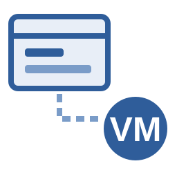

# MikeNakis.ViewModeling Building blocks for view models (MVVM) that do not depend on any GUI framework

  

## Packages

- **MikeNakis.ViewModeling**: the view models, and the `Platform` abstraction through which they access timers, prompts, the clipboard and the event loop.
- **MikeNakis.ViewModeling.Wpf**: the WPF implementation of `Platform`.
- **MikeNakis.ViewModeling.Fake**: a fake implementation of `Platform`, for testing view models without a GUI.

## License

**All rights reserved.**

For more information, see [LICENSE.md](LICENSE.md)

## Coding style

This project is written using _**my very own™**_ coding style.

More information: [michael.gr - On Coding Style](https://blog.michael.gr/post/2018-04-on-coding-style/)
